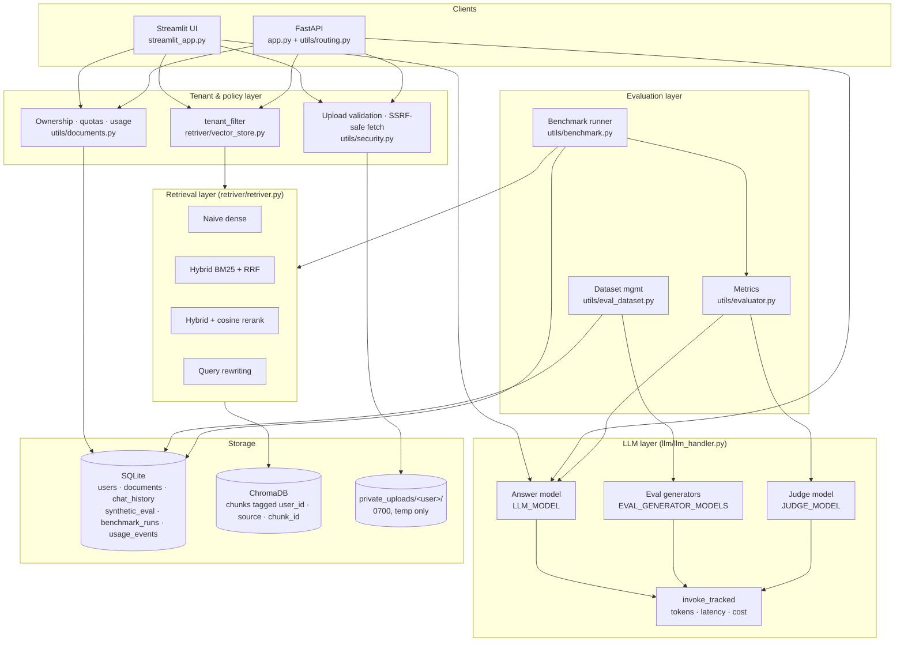
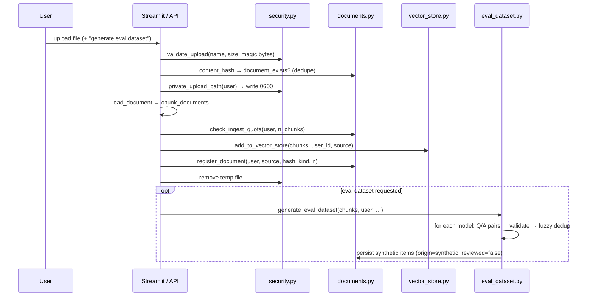
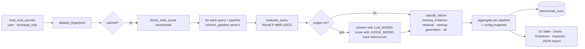
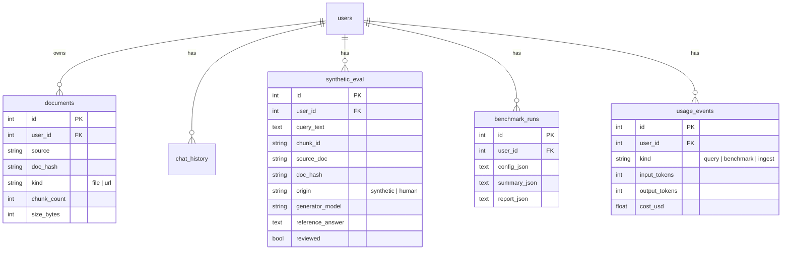

# Ragvexa — Architecture, Flows and Roadmap

This document describes how Ragvexa is built today (after the security and
evaluation upgrade), how a request moves through it, what the data model
guarantees, and what the next phases are.

---

## 1. What Ragvexa is

Ragvexa is a **RAG quality and evaluation platform**, not just a chatbot.
Each user owns a private index, can chat over it with a chosen retrieval
strategy, and can measure retrieval and answer quality with repeatable
experiments. Everything is built on the existing stack: Streamlit, FastAPI,
ChromaDB, SQLite via SQLAlchemy, and NVIDIA NIM models.

Design principles:

1. **Tenant first.** No read or delete reaches a data store without a user id.
2. **No invented numbers.** A metric that cannot be computed is reported as
   unavailable, never estimated.
3. **Same conditions for every pipeline.** One dataset, one K, one prompt set,
   one generator, one judge per run.
4. **Every run is reproducible.** The configuration that produced a number is
   stored next to the number.

---

## 2. System architecture



### Component responsibilities

| Component | Responsibility | Must not |
|---|---|---|
| `streamlit_app.py` | Auth UI, ingest, chat, benchmark tabs, ground-truth review, run history | Touch a store without `user_id`; keep cross-user state in `st.session_state` |
| `utils/routing.py` | Same features over JWT for programmatic use | Reveal existence of another user's resources (returns 404) |
| `retriver/vector_store.py` | Chroma access, `tenant_filter`, scoped add/delete/count | Accept a missing or non-integer user id |
| `retriver/retriver.py` | The four pipelines, one `PipelineResult` schema | Query without `tenant_filter`; raise on failure (falls back and sets `error`) |
| `utils/documents.py` | Ownership rows, quotas, usage log, complete deletion | Delete across users; leave eval items or chunks behind |
| `utils/security.py` | SSRF guard on every redirect hop, upload validation, private temp storage | Follow redirects blindly; trust Content-Length |
| `llm/llm_handler.py` | Model factories, `invoke_tracked`, cost from configured prices only | Guess a price |
| `utils/eval_dataset.py` | Multi-model question generation, validation, dedup, human ground truth, review flags | Store a question that fails validation; mix users |
| `utils/evaluator.py` | Retrieval metrics, judge metrics, usage accounting | Substitute a fallback score when the judge fails |
| `utils/benchmark.py` | Run all pipelines under identical settings, classify failures, persist runs, export | Compare runs with different configs silently |

---

## 3. Request flows

### 3.1 Ingest a file



### 3.2 Chat

```
question → check_daily_quota(user, "query")
         → retrieve_pipeline(question, user_id, strategy, k)   # tenant-scoped
         → generate_response_tracked(answer model, context, history)
         → memory.add_interaction + record_usage(tokens, cost)
         → answer + sources + latency/tokens/cost shown
```

### 3.3 Benchmark



Failure classification rule, per query and pipeline:

| Stage | Condition |
|---|---|
| `missing_evidence` | No labelled chunk id exists in the user's index |
| `retrieval` | Labelled chunks exist but are absent from a wide candidate pool (Naive at 4×K) |
| `ranking` | A labelled chunk is in the pool but outside top‑K |
| `generation` | Retrieval hit, but faithfulness, groundedness or correctness < 0.5 |
| `ok` | Retrieval hit and the answer (if judged) is acceptable |

### 3.4 Delete

```
delete_document(user, doc_id)
  → get_owned_document            # 404-style NotOwner if not yours
  → delete_user_source(user, src) # Chroma chunks
  → delete synthetic_eval rows for that doc_hash
  → delete documents row

delete_all_user_data(user)
  → clear_user_index + documents + synthetic_eval + chat_history
    + benchmark_runs + usage_events
```

---

## 4. Data model



ChromaDB chunks carry `{user_id, source, chunk_id}` metadata. `chunk_id` is
a content hash, so the same text in two users' documents has the same id but
is still isolated by `user_id`.

---

## 5. What the numbers mean (and what validates them)

| Number | Depends on | Validated by |
|---|---|---|
| Recall@K, Precision@K, MRR, nDCG@K | Index, embedding model, chunking, **labels** | Unit tests prove the formulas; human review proves the labels |
| Faithfulness, groundedness, relevance, correctness | Generator model, judge model, prompts | Independent judge model; **judge calibration against human ratings (Phase 2)** |
| Latency | Hardware, network, model | Measured directly |
| Tokens | API response | Exact |
| Cost | Tokens × configured prices | Only shown when prices are configured |

Changing the generator (for example to another provider) legitimately changes
the generation numbers and leaves retrieval numbers untouched. The run config
records the model ids so runs are only compared like for like.

---

## 6. Roadmap

### Phase 1 — Secure multi-user foundation ✅ (current branch)

Tenant isolation, ownership, quotas, complete deletion, upload and SSRF
hardening, cross-model eval generation, independent judge, token and cost
tracking, failure stages, persisted reproducible runs, 147 offline tests.

### Phase 2 — Trust the numbers (next)

Goal: a reviewer can defend any number in a report.

| Item | Why | Done when |
|---|---|---|
| **Judge calibration** (in progress) | Judge scores are opinions until compared with humans | Agreement per metric shown; warning when low or sample < 5 |
| Human review workflow | Reviewing in a data editor does not scale | Queue of unreviewed items, keyboard accept/reject/edit, reviewer and timestamp stored |
| Confidence intervals | Averages over 20 queries hide variance | Bootstrap 95% CI per metric; "not significant" flag when intervals overlap |
| Dataset versioning | Editing labels silently changes old runs' meaning | Named, immutable dataset snapshots; runs reference a snapshot id |
| Run comparison view | Deciding needs A vs B, not two tables | Side-by-side diff of two runs with per-query deltas |
| Real-API smoke test | All LLM paths are mocked | Opt-in test that runs one judged query against NVIDIA and asserts tokens > 0 |

### Phase 3 — Scale and operate

| Item | Why | Done when |
|---|---|---|
| Postgres + pgvector or Chroma server | SQLite and local Chroma are single-node | `DATABASE_URL` and a vector-store URL switch backends; tests pass on both |
| Background jobs | Benchmarks and eval generation block the UI | Queue (RQ or Celery) with progress polling; cancel support |
| Audit log and admin role | No visibility into who did what | Append-only events for login, ingest, delete, benchmark; admin page |
| SSO / OAuth | Password-only auth | OIDC login alongside local accounts |
| Rate limiting in Streamlit | Only the API is IP-limited | Shared limiter keyed by user id |
| Observability | No metrics or tracing | OpenTelemetry spans per pipeline stage; dashboards for latency and cost |

### Phase 4 — Better retrieval and provider freedom

| Item | Why | Done when |
|---|---|---|
| Cross-encoder reranker | Cosine rerank is weak | `bge-reranker` or NIM reranker as pipeline 5, benchmarked against the four |
| Relevance filter pipeline (e.g. Jev or a small classifier) | Drop noisy chunks before generation | Pipeline with threshold/top-n settings; precision gain vs recall loss reported |
| Multi-query and HyDE | Single query embedding misses phrasing | Two more pipelines behind the same `PipelineResult` schema |
| Chunking experiments | Chunk size dominates retrieval quality | Benchmark can sweep chunk size and overlap on a snapshot |
| Provider-agnostic LLM layer | Users ask for Groq, OpenAI, local models | `LLM_PROVIDER` setting; same `invoke_tracked` contract; prices per provider |
| Per-pipeline cost/latency budget | Choose by value, not just score | Pareto view: quality vs latency vs cost |

### Phase 5 — Product surface

| Item | Why | Done when |
|---|---|---|
| Shareable report pages | Results live inside one account | Read-only report links with expiry |
| CI regression gate | RAG quality regresses silently | CLI `ragvexa bench --snapshot X --fail-below recall=0.7` for pipelines |
| Python SDK / OpenAPI client | API is hand-called | Generated client, examples in README |
| Dataset import/export formats | Teams have labels elsewhere | BEIR-style and CSV import; export of reviewed sets |

---

## 7. Decision log

| Decision | Reason |
|---|---|
| Keep local MiniLM embeddings | No document text leaves the machine for embedding; only generation and judging call NVIDIA |
| Separate judge model by default | A model grading its own answers is biased; the UI warns if they are set equal |
| Cost shown as `n/a` without prices | A wrong cost is worse than none |
| 404 for foreign documents | Prevents enumeration of other users' ids |
| Redirect validation hop by hop | The common SSRF bypass is a public URL that redirects to an internal one |
| Synthetic labels flagged, never hidden | Numbers on unreviewed labels are relative, and the report says so |
| bcrypt directly instead of passlib | passlib is incompatible with bcrypt 5 and broke API login |
